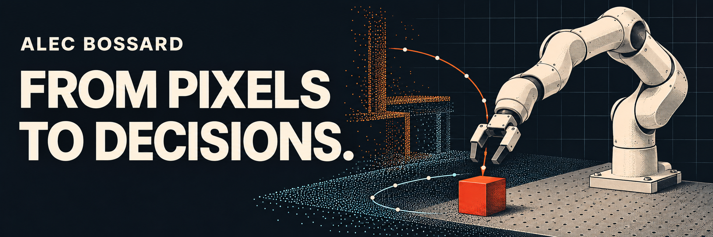

# Alec Bossard

**Robotics engineering at UPSSITECH · Former research intern at AIST Japan**

I build systems that turn sensor data into actions, and I design experiments to find out where those systems fail.

**Available for an internship · March 1 to August 27, 2027**

[Portfolio](https://alecbossard.com) · [Résumé](https://alecbossard.com/cv) · [LinkedIn](https://www.linkedin.com/in/alec-bossard/) · [Email](mailto:alecbossard@gmail.com)

## Field notes

### Perception / GeoPolicy-Bench

**50.4% fixed camera · 89.4% fixed + wrist fusion.** I built a simulated Franka Panda benchmark and measured stable placement of a single cube across nine synthetic sensor perturbation settings, with matched training and without augmentation.

[Inspect the results](https://github.com/Alecbossard/GeoPolicy-Bench#what-was-measured) · [Replay the release](https://github.com/Alecbossard/GeoPolicy-Bench/releases/tag/v4-demo)

### Motion / Path Planning Studio

**A racetrack as a test bench.** I built an interactive 3D workbench to compare racing lines, trajectory smoothing and vehicle telemetry before integration into the Formula Student ROS 2 and Gazebo simulation.

[Drive the live demo](https://path-planning-475644098248.us-west1.run.app/) · [Read the source](https://github.com/Alecbossard/Path-Planning-Studio)

### Evaluation / EarlyEval Reproduction

**700 trajectories, 350 shared tasks.** I tested whether partial LLM agent runs could predict their outcomes early enough to stop evaluation. My reduced reproduction uses held-out-agent folds and documents where the published stopping behavior did not reproduce.

[Explore the results and limits](https://github.com/Alecbossard/earlyeval-reproduction#results)

### Orchestration / TraceMedic

**An incident investigation you can replay.** With coding-agent assistance, I developed a local workbench that coordinates three LLM roles through LangGraph and MCP tools. It records source evidence and checkpoints so an investigation can resume after interruption.

[Explore the architecture and walkthrough](https://github.com/Alecbossard/TraceMedic#run-the-demo)

## On the robot and on the track

**AIST Japan · Robotics Research Intern · April–August 2026.** I developed open-vocabulary RGB-D perception using Grounding DINO and SAM 2, integrated it with a physical Franka Panda through ROS 2, and ran 47 targeted tests of the system and hardware integration.

**TLSe Racing · Driverless Team.** I worked on trajectory planning and curvature-aware control for an autonomous Formula Student car. The final approach reduced lap time from **44 s to 30 s** in simulation.
